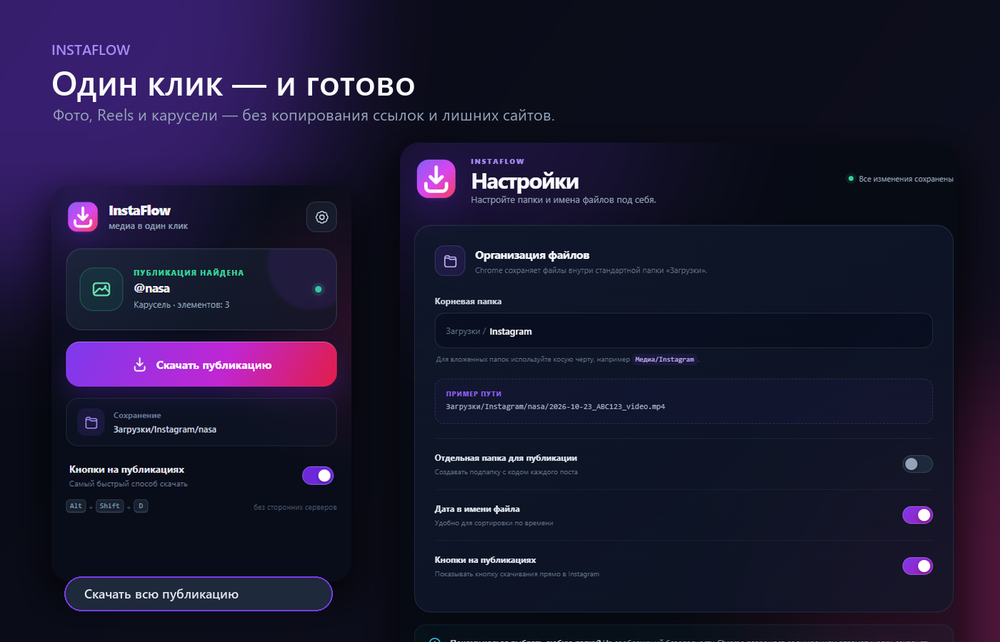

<div align="center">
  
  <h1>InstaFlow</h1>
  <p><strong>Фото, Reels и карусели Instagram — в один клик.</strong></p>
  <p>Без копирования ссылок, сторонних сайтов, рекламы и лишних окон.</p>

  <p>
    
    
    
  </p>
</div>



## Минимум действий

Обычно загрузка из Instagram выглядит так: скопировать ссылку → найти сторонний сервис → вставить ссылку → закрыть рекламу → выбрать формат → скачать.

С **InstaFlow** всё проще:

1. Откройте публикацию.
2. Нажмите **«Скачать»**.
3. Готово — вся публикация уже сохраняется в нужную папку.

Карусель не нужно перелистывать и скачивать по одному элементу. Расширение само собирает все фото и видео, выбирает максимальное доступное качество и аккуратно раскладывает файлы по аккаунтам.

## Почему удобно

| Возможность | Что это даёт |
|---|---|
| **Кнопка прямо на публикации** | Не нужно копировать ссылку или открывать другой сайт |
| **Вся карусель одним нажатием** | До 20 фото и видео загружаются в правильном порядке |
| **Автоматические папки** | Файлы сохраняются в `Instagram/<имя_аккаунта>/` |
| **Несколько быстрых способов** | Кнопка на странице, popup, контекстное меню или `Alt + Shift + D` |
| **Максимальное качество** | Выбирается лучший доступный вариант изображения или видео |
| **Локальная работа** | Нет аналитики, рекламы и сторонних серверов |

## Установка за минуту

### Готовый архив

1. Скачайте ZIP на странице [последнего релиза](https://github.com/LAPTOPDDD/instaflow-downloader/releases/latest).
2. Распакуйте архив в удобную папку.
3. Откройте в Chrome страницу `chrome://extensions`.
4. Включите **Режим разработчика**.
5. Нажмите **Загрузить распакованное расширение** и выберите распакованную папку.
6. Обновите уже открытую вкладку Instagram.

> Chrome не загружает распакованные расширения прямо из ZIP — сначала архив нужно распаковать.

### Из исходного кода

```bash
git clone https://github.com/LAPTOPDDD/instaflow-downloader.git
```

Затем выберите папку репозитория через **Загрузить распакованное расширение**.

## Как пользоваться

Выберите любой удобный вариант:

- нажмите фиолетовую кнопку **«Скачать»** прямо на публикации;
- нажмите значок InstaFlow на панели Chrome;
- используйте горячую клавишу `Alt + Shift + D`;
- выберите команду скачивания в контекстном меню.

Для закрытого аккаунта достаточно быть авторизованным в Instagram и иметь доступ к публикации.

## Куда сохраняются файлы

По умолчанию расширение создаёт понятную структуру внутри стандартной папки загрузок Chrome:

```text
Загрузки/
└── Instagram/
    └── имя_аккаунта/
        ├── 2026-10-23_ABC123_01_photo.jpg
        └── 2026-10-23_ABC123_02_video.mp4
```

В настройках можно:

- изменить корневую подпапку;
- создавать отдельную папку для каждой публикации;
- включить или убрать дату в имени файла;
- скрыть кнопки скачивания на странице Instagram.

Chrome из соображений безопасности разрешает автоматическое сохранение только внутри пользовательской папки **«Загрузки»**.

## Поддерживаемые публикации

- одиночные фотографии;
- обычные видео;
- Reels;
- фото-карусели;
- смешанные карусели с фото и видео.

## Конфиденциальность

InstaFlow не отправляет историю просмотров, cookies, ссылки или скачанные файлы на сторонние серверы. Настройки хранятся локально в профиле Chrome. Подробнее: [PRIVACY.md](PRIVACY.md).

## Для разработчиков

Проект написан на чистом JavaScript и использует Chrome Extension Manifest V3. Сборщик и внешние зависимости не требуются.

```text
manifest.json       настройки расширения
background.js       очередь загрузок и организация файлов
content.js          поиск публикаций и кнопка на странице
popup/              компактное окно расширения
options/            страница настроек
scripts/            генерация иконок, превью и ZIP
```

Проверка синтаксиса:

```powershell
node --check background.js
node --check content.js
```

Создание ZIP:

```powershell
powershell -ExecutionPolicy Bypass -File .\scripts\package.ps1
```

## Важно

Проект не связан с Instagram или Meta. Скачивайте только собственные материалы либо контент, на использование которого у вас есть разрешение.

---

<div align="center">
  <strong>InstaFlow — меньше действий, больше порядка.</strong>
</div>
